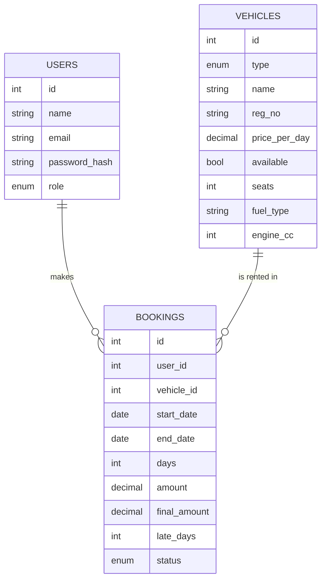

# RentWheels - Vehicle Rental & Fleet Management System

## 1. Problem analysis and design [Rubric: Problem Analysis & Design]
**Problem:** Renting a car or bike is slow and error-prone when availability, pricing and returns are tracked on paper. This app lets users browse, book and track rentals, and lets admins manage the fleet, prices and returns.

**User requirements:** register/login, search + filter vehicles, see availability, book with dates and a live price, view history, cancel an active booking.
**Admin requirements:** add/edit/delete vehicles, update price per day, see all bookings, process returns (final amount with late fee).
**Non-functional:** browser frontend + Java backend, data stored in MySQL, responsive, friendly error messages.
**Assumptions:** one booking per vehicle at a time; late fee = 1.5 x daily price per late day; passwords are stored as SHA-256 hashes (production would use bcrypt/argon2 with a salt); there is no token-based authentication (login only identifies the user in the browser), so the API trusts the caller - acceptable for a coursework demo, not for production; reminders trigger within 24 h of 12:00 noon on the return date.

### Architecture
```
Browser (HTML/CSS/JS)  --fetch JSON-->  Java server (JDK HttpServer)  --JDBC-->  MySQL
   frontend/                              backend/src/main/java/rentwheels       database "rentwheels"
```

### Folder structure
```
rentwheels/
  frontend/
    index.html              page shell + script tags
    css/style.css           styling
    js/errors.js            custom exceptions
    js/models.js            Vehicle, Car, Bike (inheritance, used for display + live price estimate)
    js/api.js               fetch() calls to the backend (replaces the old localStorage dao.js)
    js/reminder-worker.js   Web Worker (thread)
    js/app.js               UI + client-side validation
  backend/
    schema.sql              tables + seed data (MySQL)
    pom.xml                 Maven: mysql-connector-j (JDBC driver) + gson
    src/main/java/rentwheels/
      Main.java             HTTP server, REST routes, serves the frontend
      Db.java               JDBC connection + transaction helper
      UserDao / VehicleDao / BookingDao   JDBC CRUD (PreparedStatement)
      RentalService.java    business rules (booking, cancel, return, late fee) in transactions
      Vehicle, Car, Bike, Booking, User   model classes (Car/Bike extend Vehicle)
      AppException.java     business error with HTTP status
```

### Data model


### REST API
| Method + path | Purpose |
|---|---|
| POST /api/login, /api/register | authentication |
| GET /api/vehicles, GET /api/vehicles/{id} | read fleet |
| POST /api/vehicles, PUT /api/vehicles/{id}, DELETE /api/vehicles/{id} | admin CRUD |
| GET /api/bookings[?userId=n] | list bookings (with user and vehicle names via JOIN) |
| POST /api/bookings | create booking `{userId, vehicleId, start, end}` |
| POST /api/bookings/{id}/cancel, /return | cancel / process return (late fee) |
| DELETE /api/bookings/{id} | remove a finished booking |

## How to run
**Database: MySQL 8+.** (JDBC works with any database that has a driver; this project uses MySQL, driver `mysql-connector-j`.)
1. Create the database and seed data: `mysql -u root -p < backend/schema.sql`
2. Start the backend (needs JDK 17+ and Maven):
   ```
   cd backend
   # Windows PowerShell:  $env:DB_PASSWORD="your_mysql_password"
   # Mac/Linux:           export DB_PASSWORD=your_mysql_password
   mvn compile exec:java
   ```
   Optional env vars: `DB_URL` (default `jdbc:mysql://localhost:3306/rentwheels?...`), `DB_USER` (default `root`), `DB_PASSWORD`, `PORT` (default 8080), `STATIC_DIR` (default `../frontend`).
3. Open **http://localhost:8080** (the Java server also serves the frontend, so do not open index.html directly).

Logins: **admin@rent.com / admin123**, **user@rent.com / user123**.

## Rubric mapping
| Rubric item | File | Class / function |
|---|---|---|
| Problem analysis & design | README.md | Section 1 and diagrams |
| Inheritance (1M) | frontend/js/models.js, backend Vehicle/Car/Bike.java | `Vehicle`, `Car`, `Bike`; polymorphic `calculateRent()` |
| Collections (1M) | frontend/js/app.js, backend DAOs | `showCards()` (Array filter/sort); `List<Vehicle>`, `List<Booking>` in DAOs |
| Exception handling (1M) | errors.js, app.js, AppException.java, Main.java | custom errors; `run()` try/catch/finally; server maps exceptions to HTTP status |
| CRUD with JDBC (2M) | backend UserDao, VehicleDao, BookingDao, RentalService | INSERT / SELECT / UPDATE / DELETE via `PreparedStatement`; transactions in `Db.tx()` |
| GUI (1M) | index.html, css, app.js | `authView`, `userView`, `adminView`, booking modal, validation |
| Thread (1M) | js/reminder-worker.js, app.js | Worker, `startReminders()`, `stopReminders()` |

## Viva cheat sheet (25 questions)
1. **Why this project?** It naturally needs inheritance (car vs bike), collections, persistence, validation and a background task.
2. **Why abstract/base class Vehicle?** Shared fields and logic live once; subclasses add only what differs.
3. **What is inheritance here?** `Car extends Vehicle` reuses its fields and methods.
4. **What does `super()` do?** Calls the parent constructor so shared fields are set.
5. **What is polymorphism here?** `v.calculateRent(days)` runs the Car or Bike version depending on the real object.
6. **What is method overriding?** A subclass redefines a parent method (`calculateRent`, `describe`).
7. **How do Car and Bike prices differ?** Car adds Rs 300 insurance; Bike adds Rs 50 helmet fee.
8. **Why `fromObject()`?** The API returns plain JSON; it rebuilds the right Car/Bike subclass in the browser.
9. **Which collections did you use?** Array (lists) and Map (id to vehicle/user).
10. **Why Map for lookup?** Lookup by key is fast and avoids searching the array each time.
11. **Which array methods?** `filter` (type, availability, search), `sort` (price), `map` (build cards).
12. **Why custom exceptions?** They name each failure and let us show specific, friendly messages.
13. **How do errors flow?** A function throws, `run()` catches it, `AppError` shows its message, other errors show a generic one.
14. **What does `finally` do?** Always runs; we use it to refresh the reminder worker's data.
15. **Which date errors are checked?** Missing dates, start in the past, return not after start.
16. **Why a Java backend?** A browser cannot open a JDBC connection to MySQL; the Java server does the JDBC work and the browser talks to it over HTTP/JSON.
17. **How does the DAO map to JDBC?** `create/readAll/findById/update/delete` use `PreparedStatement` for INSERT/SELECT/UPDATE/DELETE; `?` placeholders prevent SQL injection.
18. **How do you stop two users booking the same vehicle?** `book()` runs in one transaction and reads the vehicle with `SELECT ... FOR UPDATE`, so the second request waits, then sees `available = false` and gets a 409 error.
19. **What is CRUD in your app?** Create booking/vehicle, read lists, update price/status, delete vehicle/booking.
20. **How is the late fee computed?** Late days x daily price x 1.5, added to the booked amount on return.
21. **How is a vehicle blocked from double booking?** `available` is set false inside the same transaction that inserts the booking; the server rejects a booking if it is already false.
22. **What is the thread?** A Web Worker that runs `check()` every 10 s on a separate thread.
23. **Why must the main thread send bookings?** Workers cannot access the DOM; the main thread fetches bookings from the API and posts them to the worker.
24. **How is it shut down?** `worker.terminate()` in `logout()`.
25. **How could it be extended?** Token/JWT authentication with role checks, a connection pool (HikariCP), payments, overlapping-date bookings, vehicle images, email reminders.
